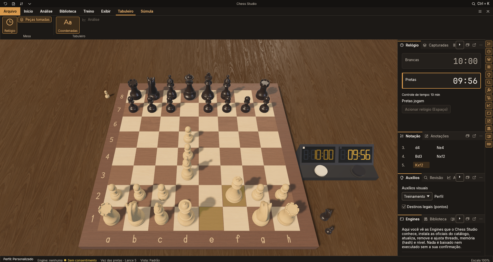
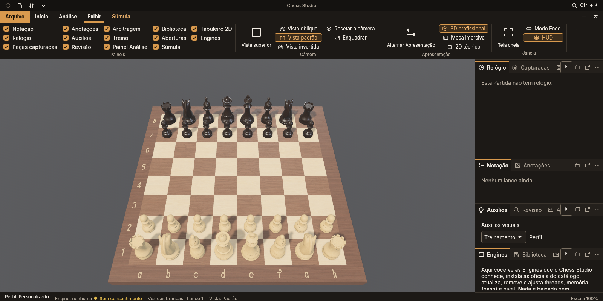
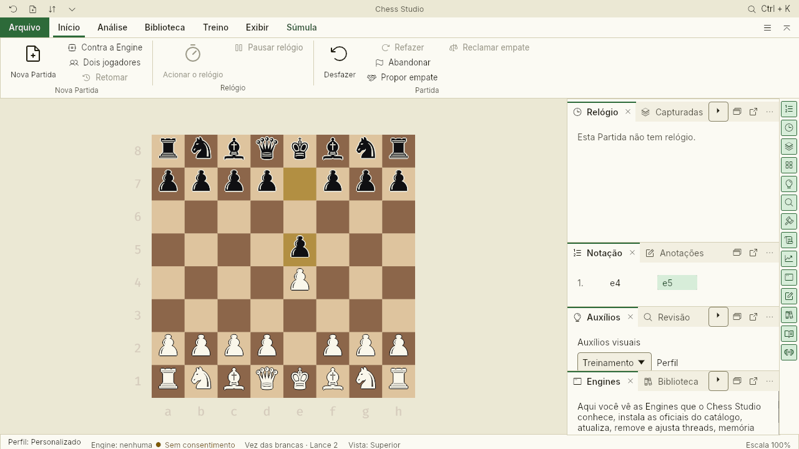
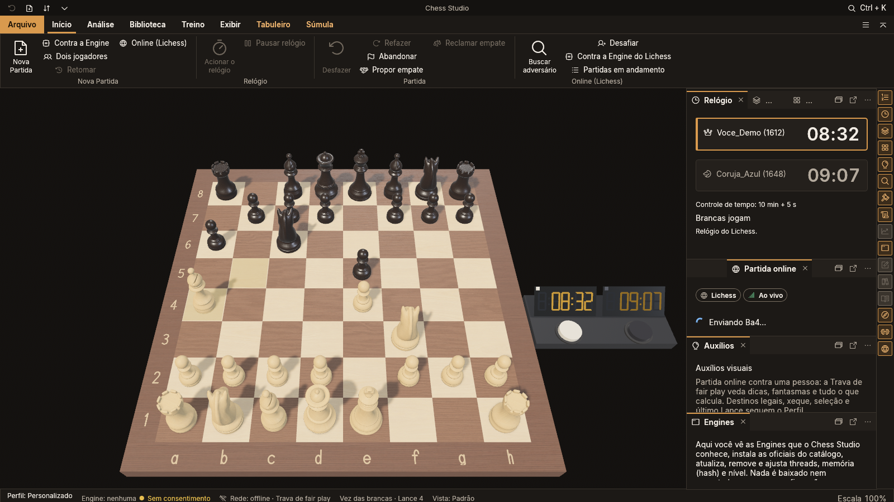
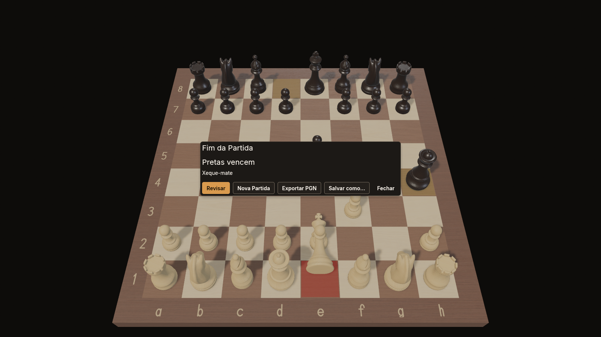

# Chess Studio

## ⬇️ Baixar: releases para Mac, Windows e Linux

**Versão `v0.1.0-rc1` (pre-release, 19/11/2026)**. [Página do release](https://github.com/ChicoFigueiredo/Chess-Studio/releases/tag/v0.1.0-rc1), com notas, `SHA256SUMS` e todos os arquivos. Versões: [todas as releases](https://github.com/ChicoFigueiredo/Chess-Studio/releases).

| Sistema | Baixe | Tipo |
|---|---|---|
| **macOS** 12 ou mais novo, chip Apple (M1, M2, M3, M4…) | [**chess-studio-0.1.0-macos-arm64.dmg**](https://github.com/ChicoFigueiredo/Chess-Studio/releases/download/v0.1.0-rc1/chess-studio-0.1.0-macos-arm64.dmg) | Disco: arraste para Aplicativos |
| **Windows** 10 e 11 (64 bits) | [**chess-studio-0.1.0-windows-x86_64-setup.exe**](https://github.com/ChicoFigueiredo/Chess-Studio/releases/download/v0.1.0-rc1/chess-studio-0.1.0-windows-x86_64-setup.exe) | Instalador (sem administrador) |
| | [chess-studio-0.1.0-windows-x86_64.zip](https://github.com/ChicoFigueiredo/Chess-Studio/releases/download/v0.1.0-rc1/chess-studio-0.1.0-windows-x86_64.zip) | Portátil: extraia e rode |
| **Linux** x86_64 (Ubuntu 24.04+, Debian 13+, Fedora 40+ e equivalentes) | [**chess-studio-0.1.0-linux-x86_64.AppImage**](https://github.com/ChicoFigueiredo/Chess-Studio/releases/download/v0.1.0-rc1/chess-studio-0.1.0-linux-x86_64.AppImage) | Arquivo único: marque como executável e abra |
| | [chess-studio_0.1.0_amd64.deb](https://github.com/ChicoFigueiredo/Chess-Studio/releases/download/v0.1.0-rc1/chess-studio_0.1.0_amd64.deb) | Pacote Debian/Ubuntu, com ícone no menu |
| | [chess-studio-0.1.0-linux-x86_64.tar.gz](https://github.com/ChicoFigueiredo/Chess-Studio/releases/download/v0.1.0-rc1/chess-studio-0.1.0-linux-x86_64.tar.gz) | Portátil: extraia e rode |

Os pacotes são gratuitos, não pedem cadastro e não são assinados digitalmente: na primeira abertura, o macOS e o Windows avisam, e [Instalar](#instalar) mostra como liberar. Antes, confira [O que você precisa](#o-que-você-precisa). Mac com processador Intel e distribuições Linux mais antigas: [compile a partir do código](#compilar-a-partir-do-código).

---

[](https://github.com/ChicoFigueiredo/Chess-Studio/actions/workflows/ci.yml) · CI/CD: [docs/ci.md](docs/ci.md)

Mesa pessoal de treinamento de xadrez para macOS, Windows e Linux, feita para você aprender a jogar no tabuleiro físico **sem depender de auxílios digitais**. Há um tabuleiro 3D sobre uma mesa discreta e um 2D técnico, três Políticas de arbitragem que simulam a Partida presencial, relógio, Súmula manual, Exercícios e análise por uma Engine UCI que você mesmo escolhe.

O app é **offline por padrão**. Partidas, treino e preferências ficam num banco SQLite no seu computador, e não há cadastro. A rede só é usada quando você liga um serviço (um Provedor, como o Lichess) ou pede um download, e o app diz antes o que vai sair ([ADR-0006](docs/adr/0006-rede-offline-por-padrao-provedores-e-conexoes.md)).


<sub>Mesa imersiva: o tabuleiro sobre a mesa, com o relógio de xadrez ao lado, como numa Partida presencial.</sub>

| | |
|---|---|
|  |  |
| **3D profissional** e o Ribbon (aba Exibir) | **2D técnico** no Tema claro Torneio |
|  |  |
| **Partida online** pelo Lichess (dados de demonstração) | **Fim da Partida**: revisar, exportar PGN ou começar outra |

> **Estado (19/11/2026):** versão 0.1.0. O primeiro pacote publicado é o pre-release `v0.1.0-rc1`. Tudo o que está descrito aqui está na `main` e coberto pela suíte automatizada, mas **a homologação pelo usuário ainda não terminou**. A interface nunca foi aprovada em janela real no Windows nem no macOS, e as integrações nunca foram conferidas com os serviços de verdade. Veja [Estado e homologação](#estado-e-homologação).

## O que você precisa

| | macOS | Windows | Linux |
|---|---|---|---|
| **Sistema** | macOS 12 Monterey ou mais novo | Windows 10 ou 11, 64 bits | x86_64 com glibc 2.39 ou mais nova: Ubuntu 24.04+, Debian 13+, Fedora 40+, Linux Mint 22+ e derivados |
| **Processador** | Chip Apple (M1 ou mais novo). Mac Intel: compile do código | Intel ou AMD de 64 bits (x64) | Intel ou AMD de 64 bits |
| **Vídeo** | Metal (todo Mac com chip Apple tem) | DirectX 12 ou Vulkan, com o driver da placa atualizado | Vulkan: driver Mesa (Intel, AMD) ou NVIDIA |
| **Espaço em disco** | cerca de 150 MB | cerca de 150 MB | cerca de 150 MB |
| **Algo a instalar antes** | Nada | Normalmente nada. Se o Windows avisar que falta `VCRUNTIME140.dll`, instale o [Microsoft Visual C++ Redistributable (x64)](https://aka.ms/vs/17/release/vc_redist.x64.exe) | `.deb`: nada, o `apt` resolve. AppImage e `.tar.gz`: `libvulkan1`, `libxkbcommon0` e, no X11, `libxkbcommon-x11-0` (já vêm na maioria dos desktops). O AppImage usa o `fusermount` (pacote `fuse3`) |

E também:

- **Internet:** não precisa para jogar, treinar nem estudar. Ela só entra para baixar o app e, se você quiser, baixar uma Engine ou ligar um Provedor (Lichess, Chess.com, FICS, PlayStrategy, FIDE).
- **Conta ou cadastro:** nenhum. Uma conta no Lichess só é necessária para as funções online dele (Partida online, Engine online, Explorador autenticado).
- **Engine (opcional):** jogar contra o computador e a Análise precisam de uma Engine UCI. Na primeira vez, o assistente de Engine procura uma instalada ou baixa o Stockfish 19 do site oficial, se você aceitar a licença dele. Também dá para instalar por conta própria (`brew install stockfish` no Mac, `sudo apt install stockfish` no Linux). Dois jogadores no mesmo computador, a Súmula e os Exercícios funcionam sem Engine.
- **Seus dados:** ficam num banco SQLite na pasta do usuário (veja [onde](docs/instalacao.md#onde-ficam-os-seus-dados)). Desinstalar não apaga as suas Partidas. Cópia de segurança e recuperação: [docs/atualizacao-e-recuperacao.md](docs/atualizacao-e-recuperacao.md).

## Instalar

Baixe o pacote do seu sistema na tabela [Baixar](#️-baixar-releases-para-mac-windows-e-linux) ou na página de [Releases](https://github.com/ChicoFigueiredo/Chess-Studio/releases). Os pacotes não são assinados, então cada sistema avisa na primeira abertura. Abaixo está como liberar. O guia completo, com desinstalação, pasta de dados e problemas comuns, está em [docs/instalacao.md](docs/instalacao.md).

### macOS (Apple Silicon: M1 ou mais novo)

Funciona no macOS 12 Monterey ou mais novo.

1. Baixe `chess-studio-0.1.0-macos-arm64.dmg` e abra o arquivo.
2. Na janela que aparece, arraste **Chess Studio** para o atalho **Applications** (a pasta Aplicativos). Depois ejete o disco "Chess Studio" pelo botão de ejetar na barra lateral do Finder.
3. Abra o Chess Studio pela pasta Aplicativos. O app não é assinado nem notarizado, então o macOS bloqueia a primeira abertura. Feche o aviso sem escolher **Mover para o Lixo**.
4. Libere o app uma vez:
   - **macOS Sequoia 15 ou mais novo:** abra o menu Apple > **Ajustes do Sistema** > **Privacidade e Segurança** e role até **Segurança**. Clique em **Abrir Mesmo Assim** e confirme; depois digite a senha de início de sessão. O botão só aparece por cerca de uma hora depois da tentativa de abrir. Nessas versões, o Control + clique > **Abrir** não libera mais o app.
   - **macOS 12 a 14 (Monterey, Ventura, Sonoma):** no Finder, dê Control + clique no Chess Studio, escolha **Abrir** e confirme **Abrir**.
   - **Pelo Terminal, em qualquer versão:** `xattr -dr com.apple.quarantine "/Applications/Chess Studio.app"`.
5. Daí em diante, o app abre com dois cliques.

Num Mac com processador Intel não há pacote: [compile a partir do código](docs/build/macos.md). Para saber o chip do seu Mac, abra o menu Apple > **Sobre Este Mac**.

### Windows 10 e 11 (x86_64)

- **Instalador (recomendado):** `chess-studio-0.1.0-windows-x86_64-setup.exe`. Ele instala só para o seu usuário, sem pedir administrador, em `%LOCALAPPDATA%\Chess Studio`, e cria o atalho no Menu Iniciar. A última página oferece um atalho na Área de Trabalho e **Executar Chess Studio**. Se o SmartScreen mostrar "O Windows protegeu o computador", clique em **Mais informações** e depois em **Executar mesmo assim**. Para desinstalar, use **Configurações > Aplicativos**.
- **Portátil:** extraia `chess-studio-0.1.0-windows-x86_64.zip` e rode `chess-studio.exe`, sem separá-lo da pasta `assets`.

### Linux (x86_64)

- **AppImage (qualquer distribuição recente):** rode `chmod +x chess-studio-0.1.0-linux-x86_64.AppImage` e abra o arquivo. Se aparecer "No suitable fusermount binary found", instale o pacote `fuse3` ou rode com `--appimage-extract-and-run`.
- **Debian e Ubuntu:** `sudo apt install ./chess-studio_0.1.0_amd64.deb`. O "Chess Studio" aparece no menu de aplicativos, com ícone.
- **Portátil:** extraia `chess-studio-0.1.0-linux-x86_64.tar.gz` e rode `./chess-studio` dentro da pasta.

Requisito: driver Vulkan (Mesa ou NVIDIA).

### Conferir o download

O release traz o arquivo `SHA256SUMS` com a soma de cada pacote. Calcule a soma do arquivo baixado e compare com a linha dele:

```bash
shasum -a 256 chess-studio-0.1.0-macos-arm64.dmg     # macOS
sha256sum -c --ignore-missing SHA256SUMS             # Linux (na pasta do download, confere tudo o que estiver lá)
```

```powershell
Get-FileHash .\chess-studio-0.1.0-windows-x86_64-setup.exe -Algorithm SHA256   # Windows (PowerShell)
```

O release traz também o `THIRD-PARTY-LICENSES`, com as licenças das dependências. O ícone do app ainda é provisório.

## Primeiros passos

- O app abre direto no tabuleiro, no Perfil de interface **Jogo físico** (tabuleiro primeiro, sem Auxílios). Não há tela de entrada nem espera por conexão.
- **Nova Partida** (Ctrl+N, aba Início): escolha a Política de arbitragem, o relógio, o seu lado e o adversário (dois jogadores neste computador ou uma Engine).
- Para jogar contra o computador, o **assistente de Engine** procura uma Engine instalada ou, se você aceitar a licença, baixa o Stockfish 19 do site oficial (veja [Engines](#engines-programas-externos)).
- A Partida é gravada a cada Lance. Não existe "Salvar": feche quando quiser e a Partida volta pausada ao reabrir ([ADR-0002](docs/adr/0002-log-de-eventos-como-fonte-de-verdade.md)).
- **Ctrl+K** abre a Paleta de Ações, uma busca por nome de tudo o que o app faz.

## O que o Chess Studio faz

### Sem internet

**Jogar**

- Três Apresentações da mesma Partida: **3D profissional**, **Mesa imersiva** e **2D técnico** (`Tab` alterna). Quatro Vistas de câmera (superior, oblíqua, padrão e invertida), órbita, deslocamento e zoom, com mouse ou trackpad. Também dá para virar o tabuleiro e mostrar coordenadas, o relógio 3D sobre a mesa e as peças tomadas em 3D.
- Três Políticas de arbitragem:
  - **Assistido:** o Lance ilegal volta à origem sem penalidade, com desfazer e Auxílios.
  - **Simulação FIDE:** Toque intencional, peça tocada, Ajuste (j'adoube), relógio e Infrações, segundo as Leis da FIDE de 1/1/2023 para partidas clássicas.
  - **Eliminação Imediata:** regra personalizada de treino, que não é FIDE. A primeira Infração encerra a Partida, ao acionar o relógio ou ao soltar a peça, como você escolher.
- Regras completas: xeque, mate, afogamento, roque, en passant, promoção, repetição tripla, 50 lances e posição morta. Também há Reclamação de empate, Proposta de empate, Pausa e Abandonar.
- Relógio com Clássico 90+30, Rápido 15+10, Blitz 5+3, base e incremento livres ou sem relógio. A tecla Espaço aciona o relógio.
- Partida contra uma Engine UCI externa, com a força limitada por Elo (ou por Skill Level, quando a Engine não anuncia Elo). Ao reabrir uma Partida contra a Engine, nada é executado até você clicar em **Conectar Engine e retomar**.
- Auxílios visuais (destinos legais, fantasmas, destaques, setas, alertas), HUD preso às casas e Perfis de auxílios (**Jogo físico**, sem nenhum; **Treinamento**). Nas Políticas competitivas, destinos legais e fantasmas nunca aparecem.

**Estudar**

- Notação automática, Painel Revisão para percorrer os Lances, Anotações de estudo por Lance (saem no PGN como comentário) e Carregar FEN.
- **Análise** por Engine, com várias linhas, profundidade e barra de avaliação colada ao tabuleiro. Ela é bloqueada durante uma Partida competitiva. Há controle de carga para o Lc0 em GPU ([docs/lc0-gpu.md](docs/lc0-gpu.md)).
- **Biblioteca** com busca por texto, jogador, resultado, Política, datas, Posição (FEN), origem, Provedor, ECO e ritmo, e com Posições favoritas. A aba **Origens** apaga as Partidas importadas por origem, sem tocar nas que você jogou.
- **Importar e exportar PGN.** A importação aceita `.pgn` e `.pgn.gz`, arquivos grandes lidos aos poucos, variações e comentários. Arquivos em Windows-1252 ou Latin-1 são convertidos com aviso. Antes de gravar, uma prévia detecta a fonte (Queen Alice, ChessBase, TWIC, PGN Mentor, Lichess, Chess.com). Fonte de uso restrito pede **Confirmo que posso usar estas Partidas**. Importar de novo não duplica nada. A exportação usa **Salvar como…**, com a janela do sistema.
- **Aberturas:** livro ECO embutido (dados CC0 do Lichess), com nomes em português e o original na dica. O **Explorador** com a fonte **Minha Biblioteca** dá a estatística das suas próprias Partidas, sem rede.
- **Súmula manual:** você anota os Lances à mão enquanto a notação automática fica oculta, como numa competição. Na Entrega da Súmula, a conferência compara cada Lance escrito com a Partida (corretos, notação errada, Lance trocado, omitidos). Ela também gera um PDF A4, anotado ou em branco, para imprimir. A Súmula nunca altera a Partida nem o PGN.

**Treinar**

- Exercícios de fábrica: xeque, xeque-mate, afogamento, roque, promoção, peão ilegal, memória de sequência e memória de posição (você remonta a Posição peça por peça).
- **Perfis de treino**, sequências de Exercícios com dificuldade e avanço gravado por jogador.
- Métricas e **Evolução** por dia, semana e Perfil de treino: Exercícios resolvidos sem Auxílios, acerto na memória, desempenho em finais.
- **Pacotes de problemas do Lichess** instalados de um arquivo `.csv` ou `.csv.zst` que você já tem, com filtro por tema, dificuldade e quantidade. Viram Exercícios numa seção própria, com a Origem. O treino nunca altera o resultado de uma Partida.

**Interface**

- **Ribbon** no estilo Office, com as abas Arquivo, Início, Análise, Biblioteca, Treino e Exibir. Tem modo clássico, simples (uma linha) e recolhido; para recolher, use Ctrl+F1 ou dois cliques numa aba. Completam a interface a Barra de Acesso Rápido, os KeyTips (Alt), a Paleta de Ações (Ctrl+K), as **Opções** (Ctrl+,) e a barra de status ([ADR-0005](docs/adr/0005-interface-ribbon-acoes-design-system-egui.md)).
- Painéis (Relógio, Notação, Análise, Aberturas, Explorador, Súmula, Treino, Biblioteca, Engines e outros) encaixados no dock, flutuantes ou destacados numa janela própria do sistema, que pode ir para outro monitor. Também há **Layouts de Tela** (Partida, Análise, Estudo, Treino e os que você salvar) e **Ocultar todos os Painéis** (Ctrl+Shift+F12).
- Cinco Perfis de interface de fábrica: Jogo físico, Treinamento assistido, Estudo e análise, Competição e Mínimo. Há também o **Modo Foco** (F10) e a **Tela cheia** (F11).
- 22 Temas (Escuro, Claro e 20 de xadrez, entre eles os de alto contraste Pretas e Brancas), Densidade confortável ou compacta e **Escala da interface de 30% a 200%**. A escala muda ao soltar o controle, aceita valor digitado e volta a 100% com Ctrl+0.
- **Mapa de controles:** todo atalho de mouse, trackpad e teclado pode ser reatribuído.
- **Perfis locais:** vários jogadores no mesmo computador, cada um com os seus dados.
- Qualidade gráfica Econômico, Equilibrado ou Ultra, com bloom opcional no Ultra.
- A janela volta com o mesmo tamanho e a mesma posição ao reabrir. No Wayland, só o tamanho volta.
- A interface é em português do Brasil, com datas na hora local.

**Para experimentar sem mexer nos seus dados:** a opção `--demo-data` (a partir do código, `cargo run -p chess-studio -- --demo-data`) abre um Perfil local de demonstração, com Partidas, Exercícios e Conexões fictícios, num banco temporário que some ao fechar. Nenhum Provedor vem ligado.

### Engines (programas externos)

O Chess Studio **nunca traz nem distribui uma Engine** ([ADR-0003](docs/adr/0003-engines-externas-download-fixado.md)). Para conseguir uma, use o assistente de Engine ou o gerenciador de Engines (Painel Engines):

- **Procurar no computador:** o app acha Engines no `PATH` e em pastas comuns, como `/opt/homebrew/bin` no Mac (`brew install stockfish`). Antes de executar um arquivo pela primeira vez, o app pede a sua confirmação e verifica se ele fala UCI.
- **Baixar do catálogo oficial:** Stockfish 19 (macOS, Windows e Linux) e Lc0 0.32.1 (só no Windows; no Linux e no macOS o app detecta um Lc0 que você instalou), mais a rede neural recomendada do Lc0. O app mostra a licença (GPL) e o tamanho, só baixa depois de você aceitar e confere cada arquivo com o SHA-256 embutido no código.
- Você pode ajustar threads, memória (hash), nível e parâmetros de cada Engine. Todo Lance proposto por uma Engine é conferido pelo núcleo de regras.

### Com internet, só quando você liga

Cada Provedor nasce **desligado**, e nenhum pedido de rede sai para um Provedor que você não ligou. Tudo se controla na **Central de Conexões** (Arquivo > Conexões). Cada Provedor tem um cartão que mostra o que dá para fazer, o interruptor **Ligado**, **O que é enviado**, a licença dos dados e as Conexões vinculadas. A barra de status mostra **Rede: offline** ou quantos Provedores estão ligados. Todo dado de fora mostra a sua Origem: Provedor, hora da consulta e licença. Guia do usuário: [docs/integracoes/guia.md](docs/integracoes/guia.md).

> Tudo nesta seção foi testado só com servidores falsos. A conferência com os serviços reais (roteiro [CX-HOM](docs/homologacao/integracoes.md)) ainda está pendente.

| Provedor | O que dá para fazer | O que precisa |
|---|---|---|
| **Lichess** | Explorador de aberturas: Mestres, Todos os jogadores e Um jogador | Ligado e com Conexão autorizada |
| | Finais exatos de até 7 peças; **Avaliação pronta (Lichess)** no Painel Análise; importar as Partidas públicas de um jogador; abrir uma Partida de referência do Explorador; baixar pacotes de problemas como Exercícios | Ligado |
| | **Partida online** pela Board API: buscar adversário, desafiar pelo nome, aceitar ou recusar desafios, jogar contra a Engine do Lichess (níveis 1 a 8) e por correspondência. O Lichess decide Lances, relógio e resultado ([ADR-0007](docs/adr/0007-partida-online-controlador-segue-o-provedor.md)) | Conexão do jogador autorizada |
| | **Engine online:** uma Engine do seu computador responde a desafios no Lichess como usuário BOT, com limites de ritmo, rating e adversário. Dá para ver a Partida dela no tabuleiro, em modo espectador | Conexão de Engine separada, num usuário do Lichess criado só para isso (a conversão em BOT não tem volta) |
| **Chess.com** | Dados públicos, só leitura: vincular e testar um nome, importar Partidas públicas. Não dá para jogar | Ligado |
| **PlayStrategy** | Vincular e testar um nome, importar Partidas públicas de xadrez padrão | Ligado |
| **FICS** | Partida online **como visitante** (sem rating e sem senha): buscar adversário, desafios, observar Partidas. A conexão do FICS não é cifrada, e o app avisa antes | Ligado |
| **FIDE** | Rating Standard, Rápido e Blitz de um ID da FIDE, consultado pelo Lichess; busca de jogador pelo nome | Lichess ligado |
| **Chess-API.com** | **Engine remota:** o Stockfish analisa no servidor. Só a Posição e a profundidade saem do computador. Nunca é a Engine padrão | Ligado e escolhida na lista de Engines |
| Queen Alice, ChessBase, TWIC, PGN Mentor | Importação manual de arquivo PGN. O app nunca entra nesses sites nem pede senha | Nada: é sem rede |

Como o app protege você na rede:

- **Autorizar o Lichess** é feito pelo navegador (OAuth2 com PKCE): você confirma na página do próprio Lichess e o app nunca vê a sua senha. O app só escuta em `127.0.0.1` durante a autorização. Também dá para usar uma chave pessoal.
- **Cofre:** autorizações e chaves ficam no cofre do sistema (Acesso às Chaves no macOS, Gerenciador de Credenciais no Windows, Secret Service no Linux). Sem ele, ficam num cofre do Chess Studio cifrado com uma **senha-mestra**. Um segredo nunca aparece em texto, log ou exportação.
- **Trava de fair play:** durante uma Partida competitiva local ou uma Partida online contra uma pessoa, ficam bloqueados nos próprios serviços Engines, Explorador, finais, avaliação pronta e análise. Numa Partida local, a Engine que é a sua adversária continua jogando. A trava só cai quando a Partida termina (na online, quando o Provedor confirma o fim).
- Os pedidos respeitam o limite de cada Provedor, as pausas pedidas pelo serviço e um cache com Origem. **Limpar dados guardados**, no alto da Central, apaga de uma vez o cache de todos os Provedores no Perfil local.

**Ainda não existe:** Partida online e Engine online no PlayStrategy; entrar no FICS com nome registrado e senha; chat, premove e reclamar empate por ausência nas Partidas online; jogar no Chess.com; Provedores pagos ou sob aprovação (aparecem na Central só como informação); ler `[%clk]` e `[%eval]` dos comentários do PGN; variantes como o Chess960.

## Controles

| Ação | Mouse / teclado |
|---|---|
| Mover peça | clique na peça e na casa de destino, ou arraste e solte |
| Ajuste (j'adoube), nas Políticas competitivas | Alt + clique |
| Orbitar a câmera | botão do meio + mover (trackpad: dois dedos) |
| Deslocar (pan) | Shift + botão do meio, ou botão direito + mover (trackpad: Shift + dois dedos) |
| Zoom | roda (trackpad: pinça) |
| Vistas | `1` superior · `2` oblíqua · `3` padrão · `4` invertida · `0` reset |
| Apresentação | `Tab` alterna 3D profissional / Mesa imersiva / 2D técnico |
| Acionar o relógio | Espaço |
| Virar tabuleiro · HUD · Coordenadas | `F` · `H` · `C` |
| Nova Partida · Desfazer · Refazer | Ctrl+N · Ctrl+Z · Ctrl+Y |
| Paleta de Ações · Opções | Ctrl+K · Ctrl+, |
| Modo Foco · Tela cheia | F10 · F11 |
| Recolher o Ribbon · Ocultar todos os Painéis | Ctrl+F1 · Ctrl+Shift+F12 |
| Escala da interface | Ctrl+= · Ctrl+- · Ctrl+0 (100%) |
| Cancelar gesto | `Esc` |

No Mac, os atalhos usam a tecla **Control**, não a Command, e Alt é a tecla **Option**. As teclas F podem exigir Fn: o macOS pode tomar o F11 para si. Todos os atalhos podem ser trocados em Arquivo > Controles….

## Compilar a partir do código

Pré-requisito: [rustup](https://rustup.rs). O toolchain certo é instalado sozinho pelo `rust-toolchain.toml`. Os guias por sistema trazem as dependências de cada um: [Linux](docs/build/linux.md) · [Windows](docs/build/windows.md) · [macOS](docs/build/macos.md).

```bash
git clone https://github.com/ChicoFigueiredo/Chess-Studio.git && cd Chess-Studio
cargo run -p chess-studio            # abre o app (a primeira compilação demora)
cargo run -p chess-studio -- --demo-data                    # dados de demonstração, num banco temporário
cargo test --workspace               # suíte automatizada
cargo run -p chess-studio --release -- --benchmark          # benchmark de 5 min (JSON + CSV em benchmarks/out/)
cargo run -p chess-studio -- --screenshot docs/evidencias/x # gera capturas e sai
scripts/benchmark_matriz.sh --minutes 5                     # matriz de benchmark do UI-12 (ver docs/benchmark.md)
scripts/smoke-offline.sh                                    # smoke test offline (Linux, binário release)
```

Para recompilar mais rápido em desenvolvimento, use `cargo run -p chess-studio --features dynamic_linking`.

## Estado e homologação

Cada parte está na `main` e passa na suíte automatizada. Uma parte só está pronta quando a matriz de aceite marca `PASS` com evidência e o usuário dá o GO. Até agora nenhuma parte recebeu o GO.

| Parte | Situação |
|---|---|
| **P0:** regras, 3 Apresentações, 3 Políticas, relógio, Engine UCI, SQLite, PGN/FEN, treino mínimo | 55 PASS, 13 UNVERIFIED, 0 FAIL ([relatório](docs/relatorios/p0.md)); parte da homologação foi feita em janela real em 09/11 |
| **V1:** painéis, F11 e Foco, HUD, biblioteca, gerenciador de Engines, Perfis locais | 29 PASS, 2 UNVERIFIED ([relatório](docs/relatorios/v1.md)) |
| **V2:** Súmula manual, conferência e PDF A4 | 3 PASS, 4 UNVERIFIED, falta verificação visual e impressão ([relatório](docs/relatorios/v2.md)) |
| **Interface nova:** Ribbon, design system, Temas, Escala, janela que lembra tamanho e posição | 22 itens UNVERIFIED, à espera do usuário nos três sistemas ([lista](docs/homologacao/interface-nova.md)) |
| **Integrações (V4):** Central de Conexões, Cofre, Lichess, Chess.com, PlayStrategy, FICS, FIDE, Engine remota e Engine online | Todos os itens do [roteiro com serviço real](docs/homologacao/integracoes.md) estão UNVERIFIED ([estado atual](docs/integracoes/estado-atual.md)). Seguem abertas a [#285](https://github.com/ChicoFigueiredo/Chess-Studio/issues/285) (`cargo deny check advisories`; não é vulnerabilidade) e a [#305](https://github.com/ChicoFigueiredo/Chess-Studio/issues/305) (regra da Trava de fair play para a Partida competitiva interrompida) |
| **Pacotes 0.1.0 (Gate D)** | Primeiro pre-release `v0.1.0-rc1`. Falta a instalação e o smoke test em Windows e macOS, o benchmark limpo e o GO do usuário ([relatório](docs/relatorios/gate-d.md)) |

O **CI/CD está desligado** desde 07/11, por decisão do usuário (a cota do GitHub Actions estourou). A validação é local (`cargo test --workspace`, clippy, fmt, `cargo deny`), e o release (`release.yml`) só roda por disparo manual ([docs/ci.md](docs/ci.md)). A lista de critérios de aceite manuais fica no artefato de progresso do projeto, na seção **Homologação**. Para atualizar e recuperar dados, veja [docs/atualizacao-e-recuperacao.md](docs/atualizacao-e-recuperacao.md).

## Documentos

| Documento | Para quê |
|---|---|
| [docs/instalacao.md](docs/instalacao.md) | Instalar, liberar o aviso do sistema, desinstalar, onde ficam os dados |
| [docs/integracoes/guia.md](docs/integracoes/guia.md) | Guia do usuário dos Provedores e Conexões, passo a passo |
| [docs/atualizacao-e-recuperacao.md](docs/atualizacao-e-recuperacao.md) | Atualizar sem perder dados, backup, banco ou Engine estragados |
| [GLOSSARY.md](GLOSSARY.md) | Linguagem de domínio canônica (pt-BR, com o nome usado no código) |
| [docs/adr/](docs/adr/) | Decisões de arquitetura difíceis de reverter |
| [Decisões da Rodada 2](docs/decisoes/2026-11-06-rodada-2.md) e [docs/decisoes/](docs/decisoes/) | DEC-21 a DEC-51 e as decisões de cada entrega (prevalecem sobre o prompt mestre) |
| [docs/relatorios/](docs/relatorios/) e [docs/homologacao/](docs/homologacao/) | Relatórios de Gate, matrizes de aceite e roteiros de homologação |
| [Prompt mestre](docs/prompts/veronica/Chess_Studio_Prompt_Mestre_Consolidado_P0_V1_V2.md) | Especificação original consolidada (fonte histórica, não editada) |
| [Issues e Project](https://github.com/ChicoFigueiredo/Chess-Studio/issues) | Controle mestre: épicos por Marco, features por Área, tickets por Gate |

## Marcos

- **P0:** protótipo jogável, offline e homologável, com regras completas, 3 Apresentações, 3 Políticas de arbitragem, relógio, Engine UCI, SQLite, PGN/FEN e treino mínimo.
- **V1:** estação de estudo, com painéis, F11 e modo Foco, HUD, biblioteca, gerenciador de Engines, Perfis de treino e Perfis locais.
- **V2:** Súmula manual, conferência e impressão A4.
- **Interface nova** (épico [#159](https://github.com/ChicoFigueiredo/Chess-Studio/issues/159)): Ribbon, lista única de Ações, design system em egui, Painéis destacados e Temas.
- **V4, Provedores e Conexões** (épico [#211](https://github.com/ChicoFigueiredo/Chess-Studio/issues/211)): rede offline por padrão, Central de Conexões, Cofre, Lichess, Chess.com, PlayStrategy, FICS, FIDE, Engine remota, Engine online e Trava de fair play.

Todos estão na `main`, com a homologação pendente.

## Licença

O código é licenciado sob sua escolha de [MIT](LICENSE-MIT) ou [Apache-2.0](LICENSE-APACHE), sem dependências GPL, AGPL ou LGPL ([ADR-0004](docs/adr/0004-licenca-mit-apache-sem-gpl.md)). As licenças das dependências estão em [THIRD-PARTY-LICENSES](THIRD-PARTY-LICENSES) e as dos assets (CC0 e OFL) em [`crates/chess-studio/assets/LICENSES.md`](crates/chess-studio/assets/LICENSES.md). Engines como o Stockfish e o Lc0 são software de terceiros (GPL), nunca distribuídos com o app: você os obtém à parte ([ADR-0003](docs/adr/0003-engines-externas-download-fixado.md)).
